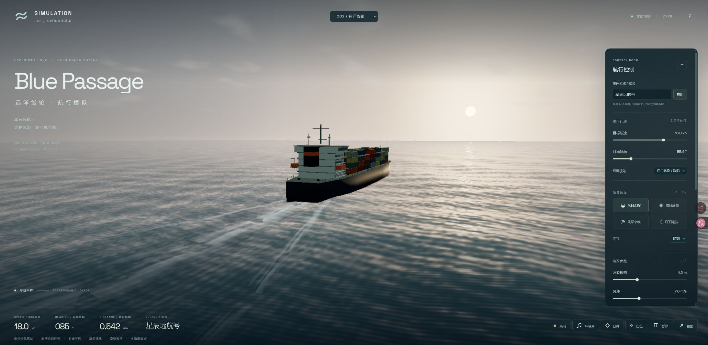
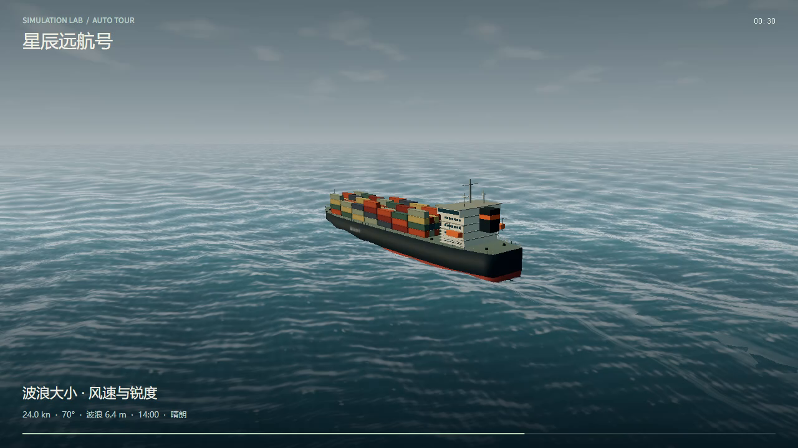

# Simulator Foundry

**A reusable Codex skill for building interactive 3D simulators, with a reproducible ocean-voyage reference implementation.**

Simulator Foundry combines an agent workflow, a runnable Three.js starter, visual references, and verification guidance. Start with the included cargo ship, reproduce its current behavior, or adapt the shared interaction and recording components to a different simulation.

The skill is invoked as **`$interactive-simulator`**. The GitHub repository is named **Simulator Foundry**; installing it does not rename the skill.



## Contents

- [What is included](#what-is-included)
- [Quick start](#quick-start)
- [Install the skill](#install-the-skill)
- [Example prompts](#example-prompts)
- [Reference simulator](#reference-simulator)
- [Recording and export](#recording-and-export)
- [Architecture and generalization](#architecture-and-generalization)
- [Reproducing the visual baseline](#reproducing-the-visual-baseline)
- [Verification](#verification)
- [Upstream projects and attribution](#upstream-projects-and-attribution)
- [Limitations and troubleshooting](#limitations-and-troubleshooting)
- [Contributing and license](#contributing-and-license)

## What is included

| Component | Purpose |
| --- | --- |
| [SKILL.md](skills/interactive-simulator/SKILL.md) | Instructions for building and improving interactive browser simulations |
| [Runnable starter](skills/interactive-simulator/assets/starter) | The complete cargo / ocean application, including source, lockfile and tests |
| [Scaffolder](skills/interactive-simulator/scripts/scaffold.mjs) | Copies the verified starter into a new empty project |
| [Architecture guide](skills/interactive-simulator/references/architecture.md) | Explains reusable interfaces and scene-specific responsibilities |
| [Ocean baseline](skills/interactive-simulator/references/ocean-baseline.md) | Documents the current visual and functional reference |
| [Quality guide](skills/interactive-simulator/references/quality.md) | Covers browser checks, camera framing, frame timing and video verification |
| [Asset manifest](skills/interactive-simulator/assets/manifest.json) | SHA-256 hashes and sizes for the 32 bundled baseline and license files |

The starter builds with code-generated geometry, shaders and synthesized audio. It does not require external 3D models, bitmap textures, audio recordings, an API key, or an AI service at runtime. Optional Google Fonts may be requested by the page; system fonts provide a fallback.

## Quick start

Requirements: Node.js **20.19+ or 22.12+**, npm, and a browser with WebGL 2. A recent Edge or Chrome is recommended for the complete video-export feature set.

```sh
git clone https://github.com/HuaJuan2023/simulator-foundry.git
cd simulator-foundry
node skills/interactive-simulator/scripts/scaffold.mjs ../my-simulator
cd ../my-simulator
npm ci
npm test
npm run dev
```

Open the local URL printed by Vite:

- `/?scene=cargo` — Blue Passage, the cargo-voyage reference (default).
- `/?scene=ocean` — Ocean Lab, with a small survey boat, buoys and barrels.

The destination must be absent or empty. Existing files are not overwritten. No dependencies are installed by the scaffolder itself.

To inspect the bundled application without copying it, run `npm ci` and `npm run dev` inside `skills/interactive-simulator/assets/starter`. For work intended to become a new simulator, prefer scaffolding so the baseline remains unchanged.

## Install the skill

Ask Codex to install the skill from this repository:

> Use $skill-installer to install skills/interactive-simulator from https://github.com/HuaJuan2023/simulator-foundry.

For manual installation, copy the complete `skills/interactive-simulator` folder to a skill discovery location used by your Codex installation. The current official guide lists `~/.agents/skills` for user skills and `.agents/skills` for repository skills. If your existing installation uses another supported skills directory, preserve that convention. Avoid installing duplicate copies under the same skill name. Codex detects skills automatically; restart it if the new skill does not appear. See the [official skills guide](https://developers.openai.com/codex/skills).

PowerShell example from the cloned repository, refusing to replace an existing skill:

```powershell
$skillDestination = Join-Path $env:USERPROFILE '.agents/skills/interactive-simulator'
if (Test-Path -LiteralPath $skillDestination) { throw 'Skill already exists.' }
New-Item -ItemType Directory -Path (Split-Path $skillDestination) -Force | Out-Null
Copy-Item -LiteralPath './skills/interactive-simulator' -Destination $skillDestination -Recurse
```

The skill's instructions and UI metadata are currently written in Chinese; the code identifiers and this README are in English. You can prompt the agent in either language. Other skill-aware agents may be able to read the folder, but they have not been independently verified here.

## Example prompts

**Reproduce the reference**

> $interactive-simulator Reproduce the included cargo-voyage simulator. Preserve the water shading, free camera, ship naming, object dragging, weather controls and automatic 30fps export. Verify it in the browser.

**Create another ocean scene**

> $interactive-simulator Build a research vessel crossing a rough sea. Add adjustable wave height, wind and daylight. Keep the vessel in view when switching presets and retain manual recording and automatic feature demonstrations.

**Adapt to a different domain**

> $interactive-simulator Build a planetary-orbit simulator with editable body names, mass and velocity controls, world-space orbit trails, pause/reset, free camera and automatic video export. Implement appropriate orbital dynamics rather than reusing the ocean model.

**Improve an existing simulator**

> $interactive-simulator Inspect this simulator's camera and recording implementation. Fix camera snapback and verify exported frame timestamps while preserving the existing scene.

## Reference simulator

### Subject and interaction

- A procedural container ship approximately 150 meters long, with hull bands, containers, bridge structures, rails, lifeboats, antennae and animated fittings.
- Target speed from 0 to 26 knots, smoothly changing actual speed and heading, and integrated distance in nautical miles.
- Drag the vessel, buoys and barrels. Drag empty water to orbit, use the right mouse button to pan, and use the wheel to zoom.
- Free follow, bridge, aerial, port-side and celestial camera presets. Presets initialize a view; subsequent free-camera input is retained.
- Apply an English or Chinese subject name. Hull markings, container labels, interface and automatic-export captions update; names persist per scene in local storage.
- Pause, resume, reset and capture PNG screenshots. Space toggles pause; H hides interface panels.

### Ocean and atmosphere

- Eight directional Gerstner components, GPU displacement and matching CPU surface sampling.
- Per-pixel short-wave normals, screen-space filtering of unresolved wave detail, Fresnel reflections, moving highlights and crest foam.
- Distance-sampled world-space wake history, expanding foam geometry and short-lived bow spray. Old tracks remain where they were generated when the vessel turns or moves.
- A local damped 2D ripple field when floating-point render targets are supported; geometric wake and spray remain available otherwise.
- Idealized sun and moon motion with configurable sunrise and sunset, clouds, stars, clear / cloudy / fog / rain conditions, and adjustable wave amplitude, wind and choppiness.
- Low-angle sunset framing with the bow oriented toward the visible sun or moon. Celestial observation includes both the light source and vessel where the supplied composition permits.



## Recording and export

Open **Record / 录制** in the bottom toolbar.

| Mode | Behavior | Important distinction |
| --- | --- | --- |
| Manual recording | Captures the raw GPU canvas through captureStream and MediaRecorder | Follows actual rendering and browser scheduling; no fixed real-time FPS guarantee |
| Automatic demonstration | Advances the simulation in fixed 1/30-second steps and encodes every frame | Produces a 30fps video independently of how long generation takes |

Both modes offer 720p / 1080p and optional synthesized environment audio. Manual recording is limited to five minutes. Automatic demonstrations offer 45- and 90-second sequences covering subject interaction, navigation, cameras, daylight, weather, waves, visualization controls and pause/resume.

Automatic export adds the subject name, telemetry, chapter labels and progress. It waits for encoder backpressure rather than dropping simulation frames. On completion or interruption, it restores saved parameters, subject position, camera/FOV, simulation time and pause state; temporary GPU ripple caches are cleared rather than serialized.

Automatic export uses WebCodecs through Mediabunny and writes H.264/AAC MP4. Manual recording prefers a supported MP4 codec and can fall back to WebM. Videos are generated locally, previewed in the application and offered for download. Desktop capture, microphone recording and server uploads are not involved.

## Architecture and generalization

Three layers are deliberately separated in the workflow:

1. **Reusable experience:** subject identity, selection/manipulation, playback, camera ownership, UI conventions, screenshots and recording.
2. **Scene-specific model:** geometry, materials, units, environment, dynamics and the effects generated by motion.
3. **Observable quality:** reference views, interaction checks, restoration behavior, video frame counts and actual browser evidence.

The reference engine exposes hooks for before-frame updates, after-render capture, state snapshots/restoration, direct stream capture and explicit export stepping. See the [adapter discussion](skills/interactive-simulator/references/architecture.md) for the actual interfaces.

**Current boundary:** the starter still contains cargo/ocean-specific branches in its UI and demonstration sequence. It is not a finished universal plugin engine. A new orbital or mechanical simulator needs its own model, controls and demonstration chapters. Extract shared services as real reuse appears, while keeping the cargo reference runnable.

## Reproducing the visual baseline

```sh
node skills/interactive-simulator/scripts/scaffold.mjs --verify
```

The verifier checks the bundled manifest before scaffolding. The lockfile preserves the tested dependency resolution. Default sunset parameters are 17:36, wave amplitude 1.2m, wind 7m/s and choppiness 0.55. The screenshot name **星辰远航号** is a QA example entered through the UI; a clean browser defaults to **HORIZON**.

Reference screenshots are visual comparison targets, not exact pixel fixtures. Wave phase, particles, viewport size, fonts and GPU output may differ. Compare subject framing, continuous wave structures, highlight behavior, scene response and camera control. Preserve the numerical meaning of units when adapting to differently sized subjects.

## Verification

The baseline was independently scaffolded into an empty directory, installed with `npm ci`, tested, built and opened in a browser.

| Check | Recorded result |
| --- | --- |
| Unit tests | 13 passing |
| Production build | Passed |
| Automatic 720p export | H.264, 1280×720, 45-second video track |
| Frame count and rate | 1,350 frames; nominal and average rate 30/1 |
| Audio | AAC; approximately 0.013s of encoder tail padding |
| Continuous frames | First 90 dynamic frames were distinct |
| Full video decode | No decoding errors |
| Camera checks | Port-side view accepts drag; noon sun and vessel fit; presets return from celestial view to the subject |

These are recorded baseline results, not guarantees for modified projects or every device. The verification record is in [baseline.json](skills/interactive-simulator/assets/quality/baseline.json). The repository includes screenshots and the record; the large local QA video is not required or bundled.

For a generated project:

```sh
npm test
npm run build
```

Tests cover celestial boundaries, camera composition, wake sampling/history/limits, Unicode names, format negotiation, demonstration coverage/restoration and fixed-frame export under asynchronous backpressure and cancellation. Browser checks remain necessary for shader compilation, framing and playback. See the [quality guide](skills/interactive-simulator/references/quality.md).

## Upstream projects and attribution

### Visual inspiration

[Fazley / @itsfazley — Ocean Lab demonstration](https://x.com/itsfazley/status/2116458255556006282) inspired the ocean-lab presentation and interaction direction. This is an independently implemented reference, not a fork of that video's project. No original source repository or source-code license for that demonstration was verified during development. Its original video, models and other assets are not redistributed here.

### Software upstreams

| Project | Role in this repository | Tested version | License |
| --- | --- | --- | --- |
| [Three.js](https://github.com/mrdoob/three.js) | WebGL renderer, geometry, materials and OrbitControls; BufferGeometryUtils supports mesh merging | 0.180.0 | [MIT](https://github.com/mrdoob/three.js/blob/r180/LICENSE) |
| [Mediabunny](https://github.com/Vanilagy/mediabunny) | WebCodecs-based video/audio encoding and MP4 output | 1.65.0 | [MPL-2.0](https://github.com/Vanilagy/mediabunny/blob/main/LICENSE) |
| [Vite](https://github.com/vitejs/vite) | Local development server and production build | 7.3.7 | [MIT](https://github.com/vitejs/vite/blob/main/LICENSE) |

The npm lockfile also records transitive build dependencies such as Rollup and esbuild. Their individual notices remain applicable. Original Simulator Foundry code is licensed separately from its dependencies; see [THIRD_PARTY_NOTICES.md](THIRD_PARTY_NOTICES.md) and [LICENSES](LICENSES).

### Workflow and platform references

- [OpenAI skills documentation](https://developers.openai.com/codex/skills) — skill packaging, discovery and invocation guidance; not a runtime API dependency.
- [Agent Skills specification](https://agentskills.io/specification) — the SKILL.md packaging convention.
- Browser WebGL, Web Audio, Canvas captureStream, MediaRecorder and WebCodecs APIs — platform capabilities used by the implementation.

Gerstner-wave mathematics is a modeling technique used by the independent shader implementation, not a claim that an external ocean shader repository was copied. No external ocean engine or pre-made 3D asset pack is bundled.

## Limitations and troubleshooting

- This is a visual simulator, not a validated hydrodynamics or navigation tool. Ship buoyancy is approximate; the ripple field is two-dimensional; there is no full six-degree-of-freedom fluid solver, collision system or route planning.
- Sun/moon paths are idealized and do not represent real location/date ephemerides. Environment audio is synthesized and is not positional spatial audio.
- Live rendering and manual recording can be throttled in background tabs. Keep the page visible, reduce resolution/quality and close competing GPU-heavy views. Automatic fixed-frame export maintains video timing at the cost of generation time.
- If automatic export is unavailable, use a recent Edge/Chrome with WebCodecs and supported H.264/AAC encoders. A supported WebGL context does not imply supported video encoders.
- A Vite large-chunk warning does not indicate a failed build; the starter includes Three.js and loads the encoding library separately.
- If the scaffolder refuses a target, choose a new empty folder. It deliberately does not merge or replace an existing project.
- If verification reports a checksum mismatch, inspect the changed baseline asset. Update hashes only after intentionally accepting and revalidating a new baseline; do not bypass the check to conceal drift.

## Contributing and license

Contributions should preserve a runnable reference and explain the affected scene, visible behavior and verification. Keep scene-specific physics separate from general-purpose interaction rules. Include browser evidence for visual/camera changes and frame-count evidence for export changes. Do not commit node_modules, build output, credentials or third-party reference videos.

Simulator Foundry's original code, skill instructions and generated reference images are available under the [MIT License](LICENSE). Dependencies retain their respective licenses. This project is not affiliated with or endorsed by OpenAI, the upstream libraries, or the author of the inspiration video.
